# Glashaus · Design-Dashboard für ioBroker VIS 2

**Deutsch** · [English](README.en.md)

[](https://djlex83.github.io/glashaus-vis2/)
[](https://github.com/ioBroker/ioBroker.vis-2)
[](#schnellstart)
[](LICENSE)

**Live-Demo:** [Zuhause](https://djlex83.github.io/glashaus-vis2/) · [Energie](https://djlex83.github.io/glashaus-vis2/energie.html) · [Heizung](https://djlex83.github.io/glashaus-vis2/heizung.html) · [Geräte](https://djlex83.github.io/glashaus-vis2/geraete.html) · [Einfahrt](https://djlex83.github.io/glashaus-vis2/einfahrt.html) · [Haus](https://djlex83.github.io/glashaus-vis2/haus.html) · [Zimmer](https://djlex83.github.io/glashaus-vis2/zimmer.html)  
Englische Oberfläche: [https://djlex83.github.io/glashaus-vis2/en/](https://djlex83.github.io/glashaus-vis2/en/) · Umschalter **DE | EN** in der Navigation jeder Seite.

Ein Dashboard-Entwurf für ein Smart Home mit ioBroker: Milchglas-Kacheln, ruhige Typografie und je Seite eine Linienzeichnung im Hintergrund, die bei Berührung in Partikel zerfließt. Jede Seite ist eine einzelne HTML-Datei ohne Build-Werkzeuge und ohne Framework. Sie läuft im Browser, auf einem Wand-Tablet oder als Vorlage für VIS 2.

> Alle Werte sind Demo-Werte, das Haus ist erfunden. Die Tabelle „In VIS 2 übernehmen“ auf jeder Seite zeigt, welcher ioBroker-Datenpunkt wohin gehört (mit Beispiel-IDs).

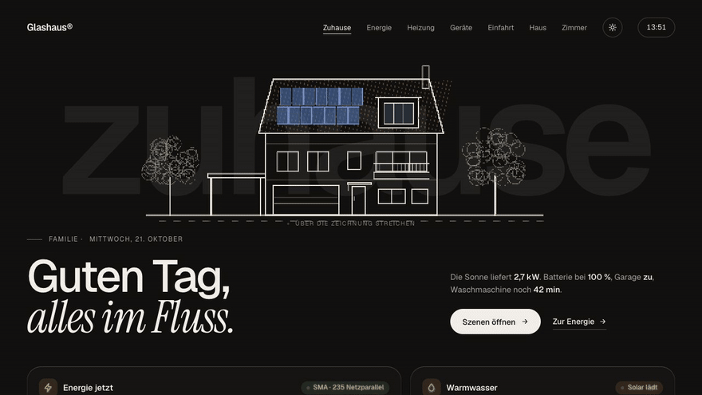

| Hausmodell drehen und aufklappen | Zimmer mit Lichtszenen |
|---|---|
| 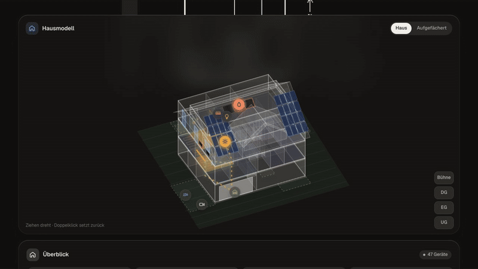 | 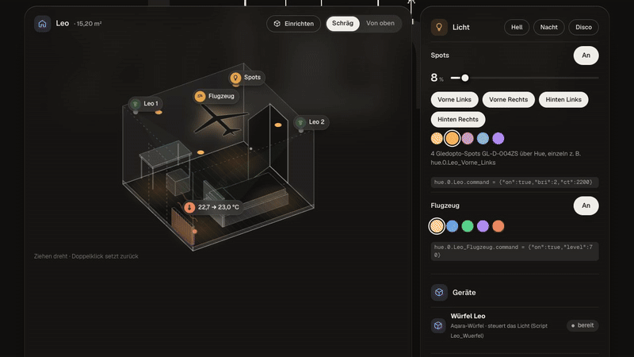 |
| **Kamera: Auto kommt heim, Live-Popup** | **Energie: Jahres-Skyline in 3D drehen** |
| 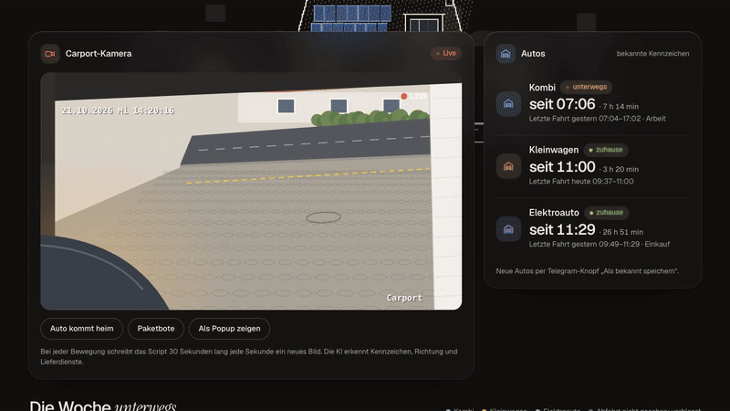 | 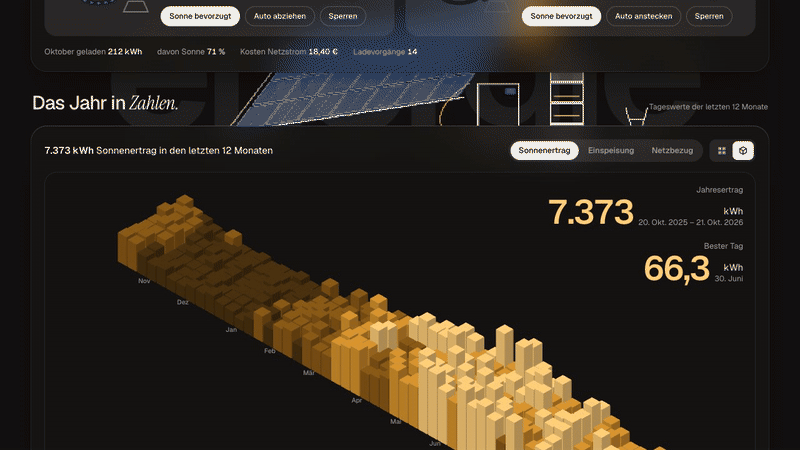 |
| **Hell und dunkel umschalten** | **Zimmer einrichten: Möbel ziehen und drehen** |
| 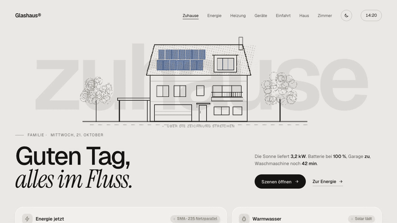 | 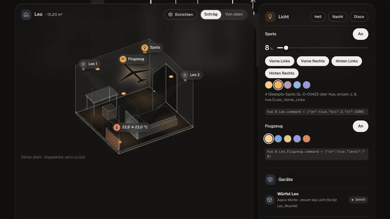 |
| **Wetter im Hausbild: Sonne, Regen, Gewitter, Schnee, Nebel, Wind** | |
| 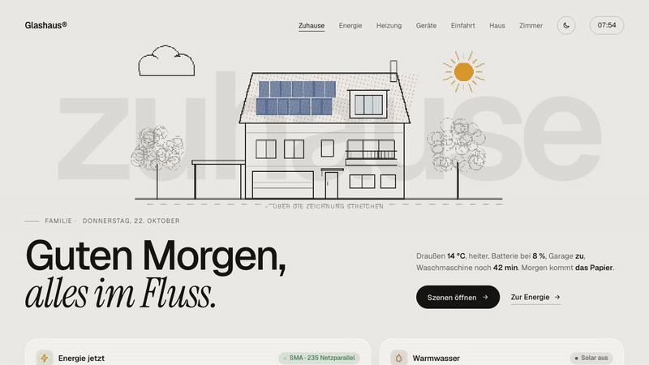 | |

## Seiten

| Seite | Inhalt |
|---|---|
| **Zuhause** (`index.html`) | Übersicht: Energie jetzt, Warmwasser, Szenen, Schalter, Hausgeräte, Meldungen, Wetter über die volle Breite mit 24 Stunden und 7 Tagen (zeichnet sich ins Hausbild), Müllabfuhr |
| **Energie** | PV, Batterie, Netz, Jahres-Skyline in 3D mit Vorjahren zum Vergleich (+/−), Wallboxen mit „Laden mit Sonne“ |
| **Heizung** | Speicher, Zirkulation, Heizkreis, Räume, Wärmejahr mit Vorjahren |
| **Geräte** | Waschmaschine, Trockner, Spülmaschine, Echos |
| **Einfahrt** | Kamera mit Bewegungs-Popup, Autos, Fahrtenbuch, Garage, Besucher, Abfuhrkalender zum Durchblättern mit Leerungen (✓ Uhrzeit, nicht rausgestellt durchgestrichen), Restmüll-Gebühr |
| **Haus** | Isometrisches 3D-Modell aller Geschosse mit jedem Gerät, Geräteliste (Shelly, Zigbee, WLED) |
| **Zimmer** | Jedes Zimmer in 3D mit Lampen, Heizung, Meldern; Einrichten-Modus zum Verschieben von Möbeln, Fenstern, Türen, Lampen |

| | |
|---|---|
| 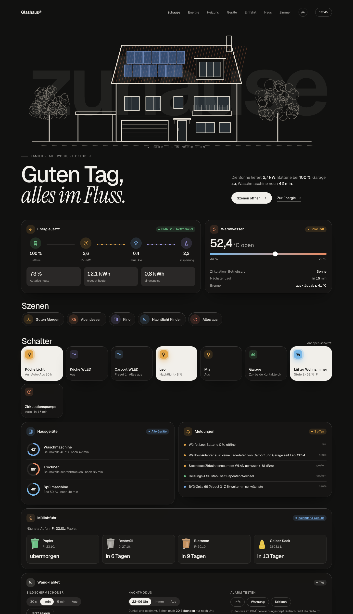 | 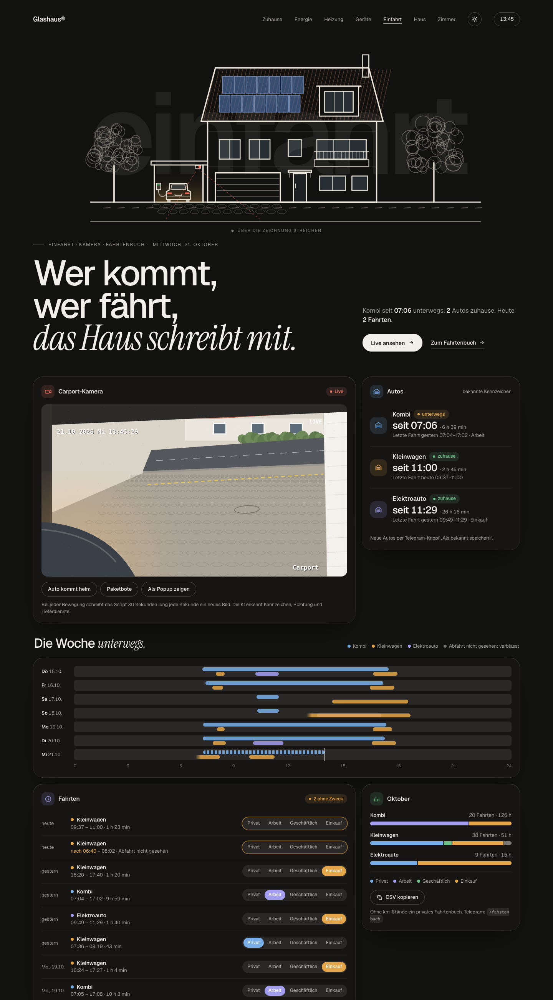 |
| 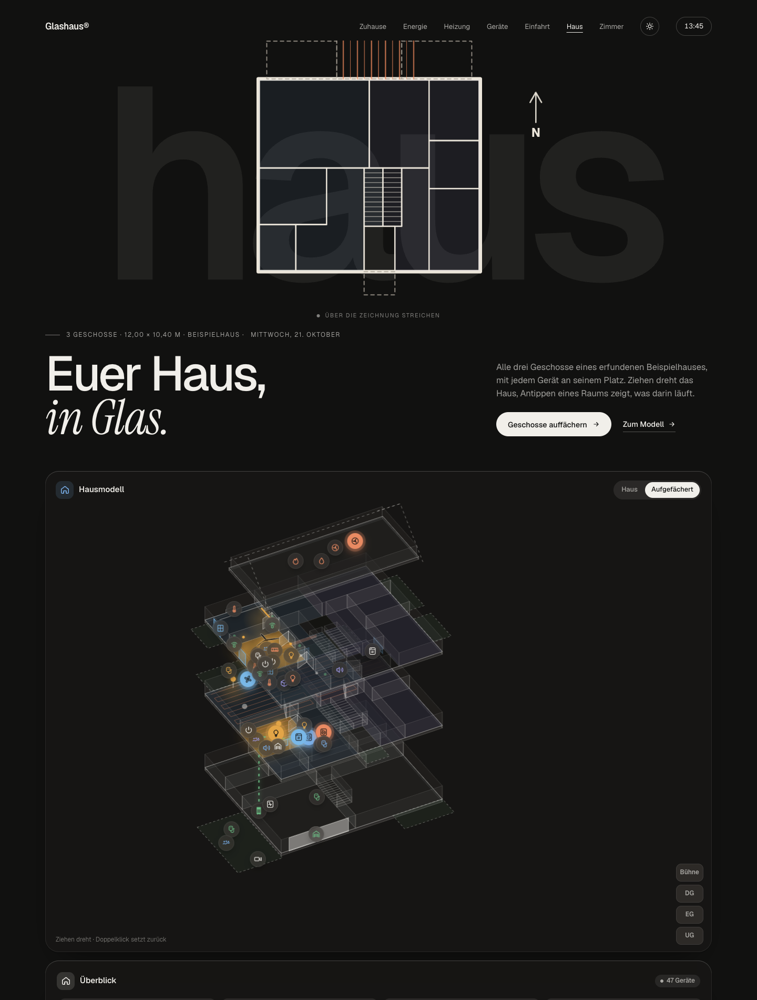 | 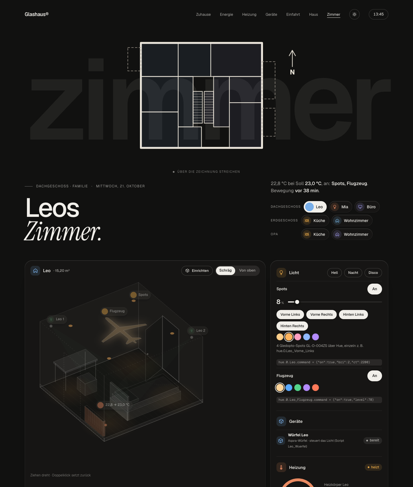 |
| 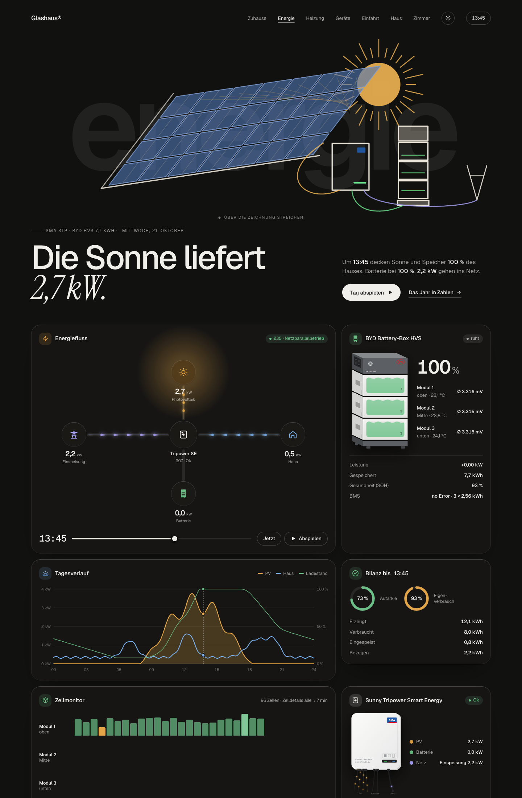 | 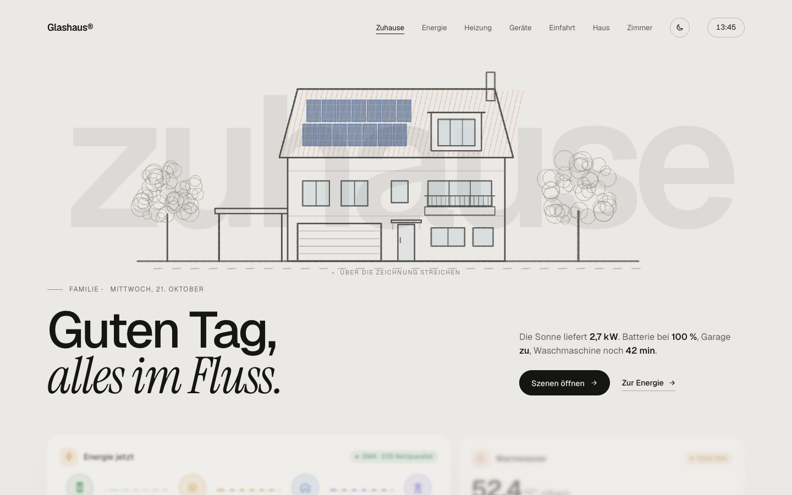 |

Hell und dunkel folgen dem System, oben rechts lässt es sich umschalten. Auf dem Wand-Tablet gibt es Bildschirmschoner, Nachtmodus und Anruf-/Bewegungs-Popups.

**Standby:** Uhr links unten, rechts die wichtigsten Werte als Kacheln (Dach, Batterie, Haus, Warmwasser, Außen mit Tiefst-/Höchstwert, Garage, Müll, laufende Geräte). Antippen öffnet die passende Seite; am Vortag der Abfuhr leuchtet die Müll-Kachel in der Farbe der Tonne, auch nachts.

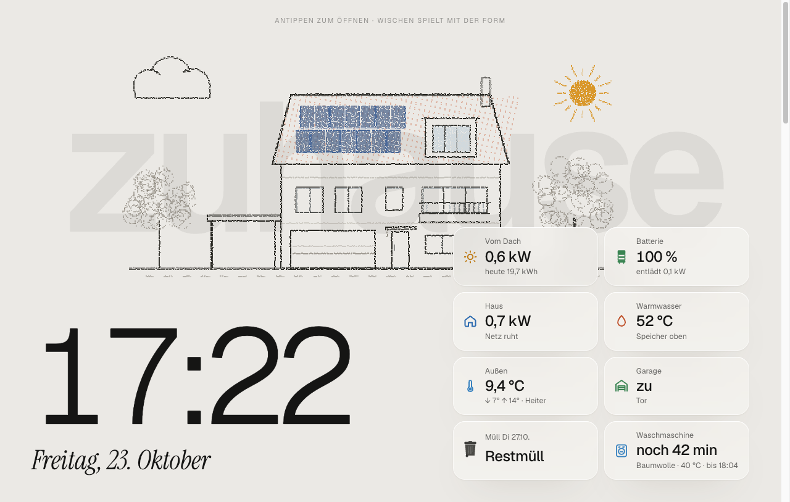

## Schnellstart

```bash
python3 build.py                                   # baut alle Seiten nach docs/ (Deutsch) und docs/en/ (Englisch)
python3 -m http.server 8765 --directory docs       # dann http://localhost:8765 öffnen
bash .claude/skills/glashaus/check.sh              # Syntax und Platzhalter prüfen
```

`docs/` ist fertig gebaut und wird über GitHub Pages als [Live-Demo](https://djlex83.github.io/glashaus-vis2/) ausgeliefert.

## Aufbau

```
build.py            setzt src/ zu eigenständigen Seiten in docs/ zusammen, übersetzt nach docs/en/
src/i18n/en.json    englisches Wörterbuch für build.py
src/base.css        Design-Tokens (hell/dunkel), Glas, 12-Spalten-Raster, Tablet, Popups
src/sprite.html     SVG-Icons (#i-…)
src/common.js       Helfer, Linienmotive je Seite (ART), Tablet-Modus, Kamera-Szene,
                    Bewegungs- und Anruf-Popup, Demo-Daten, Grundriss (PLAN), Müllkalender
src/sculpture.js    Partikel-Hintergrund (Canvas 2D)
src/skyline.js      3D-Jahres-Skyline
src/rooms.js        Zimmer-Konfiguration (Lampen, Geräte, Heizung, Melder, Fenster, Türen, Möbel)
src/<seite>.html    zuhause, energie, heizung, geraete, einfahrt, haus, zimmer
```

Die Seiten-HTML-Dateien enthalten Markierungen (`/*COMMON_JS*/`, `/*BASE_CSS*/`, `<!--SPRITE-->` …), die `build.py` durch die gemeinsamen Dateien ersetzt. Links zwischen den Seiten stehen als `__URL_<SEITE>__` in den Quellen.

## Eigenes Haus eintragen

1. **Grundriss:** `PLAN` in `src/common.js`. Je Geschoss ein Umriss (`foot`) und Räume als Polygone in Metern (`p`), dazu Wohneinheit `u` (`H` Familie, `O` zweite Wohnung, `S` gemeinsam, `X` draußen).
2. **Zimmer:** `ZC` in `src/rooms.js`. Lampen, Heizkörper, Melder, Fenster, Türen und Möbel, Positionen als Anteile `u/v` des Raums oder Wand + Position (`wall: 'n'|'e'|'s'|'w'`, `t`). Im Einrichten-Modus der Seite Zimmer lässt sich alles mit der Maus verschieben und als JSON kopieren.
3. **Geräte im Hausmodell:** `DEV` in `src/haus.html` (Raum `r`, Position `uv`, Icon, Datenpunkt), Geräteliste `INV`.
4. **Hausansicht:** `ART.zuhause` in `src/common.js` zeichnet die Straßenansicht in Metern über `M(x, y)`.
5. **Datenpunkte:** In den Tabellen „In VIS 2 übernehmen“ die eigenen ioBroker-IDs eintragen.

## Mit Claude Code weiterentwickeln

Unter [`.claude/skills/glashaus/SKILL.md`](.claude/skills/glashaus/SKILL.md) liegt ein Skill, der Claude Code erklärt, wie das Projekt aufgebaut ist, wie gebaut, geprüft und getestet wird und welche Design- und Datenschutzregeln gelten. Er wird automatisch geladen, wenn Claude Code in diesem Ordner arbeitet.

## Datenschutz

Dieses Repository enthält bewusst **kein echtes Haus**: Grundriss, Hausansicht, Namen, Orte, Abfuhrtermine, Gebühren und alle Geräte-IDs sind erfunden oder ersetzt. Wer es für das eigene Zuhause nutzt, sollte vor einem Veröffentlichen dasselbe tun (siehe Abschnitt „Datenschutz“ im Skill).

## Mitmachen

Jeder darf das Projekt forken, verändern und Verbesserungen als Pull Request vorschlagen, siehe [CONTRIBUTING.md](CONTRIBUTING.md).

## Versionen

| Version | Inhalt |
|---|---|
| 1.1.0 | Standby mit Info-Kacheln, Jahres-Skyline mit Vorjahren als Streifen, Wetter mit 24 Stunden und 7 Tagen, Abfuhrkalender mit Monaten und Leerungen, offene Türen bei Waschmaschine und Trockner, Version in der Fußzeile |
| 1.0.0 | Erste Fassung: sieben Seiten, Beispielhaus, englische Oberfläche, Wetter im Hausbild |

## Lizenz

MIT, siehe [LICENSE](LICENSE). Schriften: Geist und Instrument Serif über Google Fonts (SIL Open Font License).
